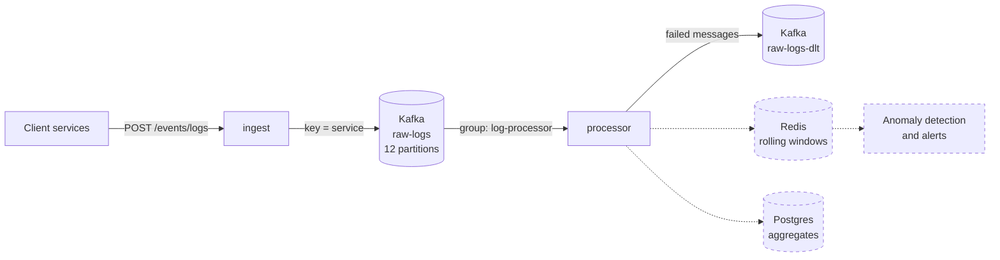

# Log Analytics Platform

A log ingestion and analysis pipeline built with Java, Spring Boot and Kafka. Services
send their logs over HTTP; the platform buffers them in Kafka and processes them in a
separate service, with real-time per-service error tracking and anomaly detection
planned next.

> **Status: work in progress.** Ingestion and consumption work end to end. See the
> [roadmap](#roadmap) for what is built and what comes next.

## Why

In a system with dozens of microservices, logs are scattered across machines. When
something breaks, you need one place that collects every log, survives traffic spikes
(which happen exactly when things break), and can tell you that a service is failing
before users do.

This project builds that pipeline with the engineering concerns of a real one:
durability under failure, back-pressure, independent scaling of intake and processing,
and explicit delivery guarantees.

## Architecture



Solid lines are built. Dashed components are planned.

| Component | Role |
| --- | --- |
| **ingest** | Spring Boot service. Accepts logs over HTTP and publishes them to Kafka. |
| **Kafka** | Durable, append-only log. Absorbs spikes, decouples intake from processing, and keeps raw logs for replay. |
| **processor** | Spring Boot service. Consumes `raw-logs` as part of the `log-processor` consumer group. |
| **raw-logs-dlt** | Dead letter topic. Holds messages that could not be processed, unchanged, with the error details in headers. |

Ingest and processor are separate services on purpose: a processing failure or
redeploy does not stop log intake, and each service scales on its own axis (HTTP load
versus partition count).

## How a log flows through the system

**Ingest**

1. A service sends a log as JSON to `POST /events/logs`.
2. `LogProducer` calls `KafkaTemplate.send()` with `service` as the key. The key
   decides the partition (`hash(service) % 12`), so all logs from one service land in
   the same partition, in order.
3. The endpoint returns **202 Accepted** right away, before Kafka confirms the write.
4. When Kafka confirms, a `whenComplete` callback logs the partition and offset. If the
   write fails, it logs an error.
5. If Kafka is unreachable, `send()` blocks for up to 3 s (`max.block.ms`) while
   fetching metadata. The failure is logged and the request still returns 202
   (see ADR-004).

**Processor**

1. Every processor instance joins the `log-processor` consumer group. Kafka assigns
   each of the 12 partitions to exactly one instance in the group.
2. Each instance polls its partitions for messages after the group's committed offset.
   If the group has no committed offset for a partition yet, it starts from the
   earliest message (`auto-offset-reset: earliest`).
3. Each message is deserialized from JSON into the processor's own `LogEvent` type.
   Type headers are ignored: the JSON payload is the only contract between the
   services, so ingest can change its internal classes freely.
4. For each message, `RawLogListener` logs the partition, offset, service and level.
5. After the listener returns, Spring commits the offset, moving the group's position
   forward. Because the commit happens after processing, delivery is at-least-once: a
   crash between processing and commit means the message is processed again.
6. A message that fails is sent to the `raw-logs-dlt` dead letter topic, and the
   consumer moves on. Without this, a single malformed message (a "poison pill")
   would fail on every poll and block the whole consumer.
   - A message that is not valid JSON goes to the DLT right away. Retrying cannot
     fix broken data.
   - If the listener itself fails, it is retried twice, one second apart, before
     going to the DLT.
   - The DLT keeps the original bytes unchanged, plus headers with the exception,
     stack trace, and the original topic, partition and offset. The message can be
     inspected and replayed.
   - The DLT has 12 partitions because a failed message keeps its partition number.

## Design decisions

Each decision is recorded with its context, rationale and trade-offs in
[`docs/decisions.md`](docs/decisions.md).

| ADR | Decision | In one line |
| --- | --- | --- |
| 001 | Kafka instead of a message queue | Reading does not delete, so consumers can replay and read independently. |
| 002 | `service` as the partition key | Keeps each service's logs on one partition, so its counters live in one place. |
| 003 | 12 partitions | Room to scale consumers without adding partitions, which would remap keys. |
| 004 | 202 even when Kafka is down | Do not page sending teams for our outage; the alert belongs on our side. |
| 005 | Dead letter topic for failed messages | Keep failed messages instead of dropping them, without blocking the consumer. |

## Tech stack

- Java 17, Spring Boot 4, Spring for Apache Kafka
- Apache Kafka 3.9 (KRaft mode, no ZooKeeper)
- Docker Compose for local infrastructure
- Maven (via the Maven Wrapper)

## Running locally

### Prerequisites

- Docker
- JDK 17

Maven is not required; each service ships with the Maven Wrapper.

### 1. Start the infrastructure

```bash
docker compose up -d
```

This starts Kafka and Redis. Redis is not used by the services yet. Kafka data lives in the `kafka-data` volume, so topics and messages survive container
restarts. `docker compose down -v` deletes them.

### 2. Start the services

In two separate terminals:

```bash
cd ingest
./mvnw spring-boot:run
```

```bash
cd processor
./mvnw spring-boot:run
```

On Windows, use `.\mvnw.cmd` instead of `./mvnw`.

The `raw-logs` topic is created by ingest on startup, and `raw-logs-dlt` by processor,
both with 12 partitions, so there is no manual setup.

### 3. Send a log

```bash
curl -X POST http://localhost:8080/events/logs \
  -H "Content-Type: application/json" \
  -d '{"timestamp":"2026-10-13T12:00:00Z","service":"payment-api","level":"ERROR","message":"Connection timeout to billing-db","traceId":"a3f9c2","durationMs":5012}'
```

On Windows PowerShell:

```powershell
Invoke-RestMethod -Method Post -Uri http://localhost:8080/events/logs `
  -ContentType "application/json" `
  -Body '{"timestamp":"2026-10-13T12:00:00Z","service":"payment-api","level":"ERROR","message":"Connection timeout to billing-db","traceId":"a3f9c2","durationMs":5012}'
```

The request returns `202 Accepted`. The processor logs a line like:

```
Partition: 10 Offset: 0 Key: payment-api Service: payment-api Level: ERROR
```

### 4. Inspect the consumer group

```bash
docker exec -it kafka /opt/kafka/bin/kafka-consumer-groups.sh \
  --bootstrap-server localhost:9092 --describe --group log-processor
```

Shows, per partition, the group's committed offset, the end of the log, and the lag
between them.

### 5. See a failed message in the dead letter topic

Send a message that is not JSON:

```bash
docker exec -it kafka /opt/kafka/bin/kafka-console-producer.sh \
  --bootstrap-server localhost:9092 --topic raw-logs
```

Type `not json`, press Enter, then Ctrl+C. Then read it from the DLT, with its headers:

```bash
docker exec -it kafka /opt/kafka/bin/kafka-console-consumer.sh \
  --bootstrap-server localhost:9092 --topic raw-logs-dlt \
  --from-beginning --property print.headers=true --max-messages 1
```

The headers include the exception and its stack trace. Some headers (partition,
offset, timestamp) are binary numbers and are not readable in the console.

## API

### `POST /events/logs`

| Field | Type | Required | Example |
| --- | --- | --- | --- |
| `timestamp` | ISO-8601 instant | no | `2026-10-13T12:00:00Z` |
| `service` | string | yes | `payment-api` |
| `level` | string | yes | `ERROR` |
| `message` | string | yes | `Connection timeout` |
| `traceId` | string | no | `a3f9c2` |
| `durationMs` | number | no | `5012` |

Returns `202 Accepted`. The log is accepted for processing; delivery to Kafka is
confirmed asynchronously.

## Configuration

| Property | Service | Default | Purpose |
| --- | --- | --- | --- |
| `logpipe.topic` | both | `raw-logs` | Topic for raw logs |
| `logpipe.partitions` | ingest | `12` | Partition count used when creating the topic. Do not increase on an existing topic (see ADR-003). |
| `spring.kafka.producer.properties.max.block.ms` | ingest | `3000` | How long `send()` may block when Kafka is unavailable |
| `spring.kafka.consumer.group-id` | processor | `log-processor` | Consumer group |
| `spring.kafka.consumer.auto-offset-reset` | processor | `earliest` | Where a new group starts reading |

## Project structure

```
log-analytics-platform/
├── docker-compose.yml        Kafka (KRaft) with a persistent volume, and Redis
├── docs/
│   └── decisions.md          Architecture decision records
├── ingest/                   HTTP intake → Kafka producer
│   └── src/main/java/com/logpipe/ingest/
│       ├── config/           Topic creation on startup
│       ├── controller/       REST endpoint
│       ├── dto/              LogEvent
│       └── service/          Kafka producer
└── processor/                Kafka consumer
    └── src/main/java/com/logpipe/processor/
        ├── config/           Retries and the dead letter topic
        ├── dto/              LogEvent (the processor's own copy)
        └── listener/         RawLogListener
```

## Roadmap

- [x] Kafka in Docker with a persistent volume
- [x] Ingest service: HTTP endpoint, async producer keyed by service
- [x] Topic created from code with 12 partitions
- [x] 202 Accepted with error logging when Kafka is unavailable (ADR-004)
- [x] Processor service: consumer group with at-least-once delivery
- [x] Typed `LogEvent` deserialization in the processor, with no type headers between services
- [x] Malformed messages are logged and skipped instead of blocking the consumer
- [x] Dead letter topic for failed messages, with retries for listener failures
- [ ] Redis: per-service rolling error-rate windows and deduplication
- [ ] Anomaly detection and alerting
- [ ] Postgres: hourly aggregates with idempotent writes
- [ ] Docker images for both services and deployment to AWS
- [ ] Grafana dashboards: throughput, consumer lag, dropped logs
- [ ] Load tests with documented throughput and latency
