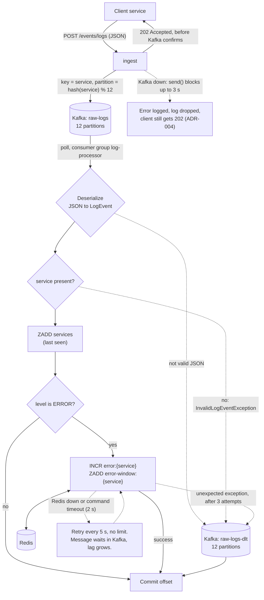
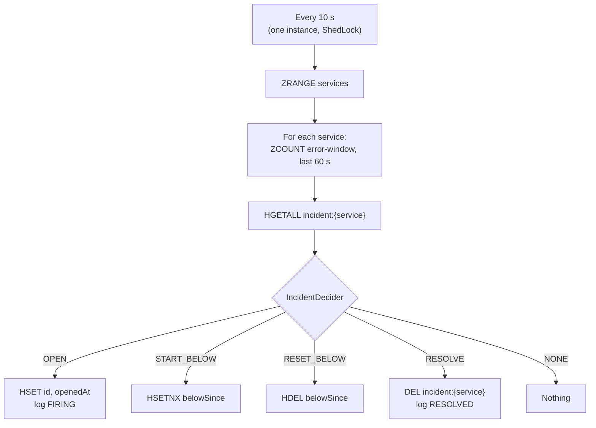

# Message flow

How a single log moves through the platform, including what happens when each step
fails. Solid lines are the normal path; dotted lines are failure paths.

## Steps

| Step | What happens | If it fails |
| --- | --- | --- |
| Client to ingest | The client sends a log as JSON over HTTP. | Invalid request body: `400 Bad Request`. |
| ingest to Kafka | `KafkaTemplate.send()` with `service` as the key. The endpoint returns `202 Accepted` without waiting for Kafka. | Kafka unreachable: `send()` blocks for up to 3 s (`max.block.ms`), the error is logged, and the client still gets `202` (ADR-004). |
| Kafka to processor | The processor polls `raw-logs` as part of the `log-processor` consumer group. Each partition is read by one instance. | The processor is down: logs wait in Kafka and are read when it returns. |
| Deserialize | `ErrorHandlingDeserializer` turns the JSON into the processor's own `LogEvent`. | Not valid JSON: published to the DLT immediately, as the original bytes. |
| Validate | The listener checks that `service` is present. | Missing `service`: `InvalidLogEventException`, published to the DLT immediately, as JSON. |
| Register | Every log, at any level, records its service in the sorted set `services`, scored by the Kafka record timestamp. The detector reads this set to know which services to check. | Same as Count below: a Redis failure is retried every 5 s. |
| Count | For `ERROR` logs, `INCR error:{service}` (total) and a one-minute sliding window in the sorted set `error-window:{service}`: member `partition:offset`, score the Kafka record timestamp. Each service has one partition and so one writer, so no transaction is needed. | Redis down or a command times out after 2 s: retried every 5 s with no limit. Never sent to the DLT (ADR-006). Any other exception: retried twice, 1 s apart, then published to the DLT. |
| Commit | The offset is committed after processing, so delivery is at-least-once. | A crash before the commit: the message is processed again. |

## Why failures take different paths

A **bad message** fails the same way on every attempt, so retrying only delays the
messages behind it. It goes to the DLT, and the consumer moves on.

An **infrastructure failure** affects every message, valid ones included. Sending them
to the DLT would empty the topic silently while consumer lag stays at 0. Instead, the
messages wait in Kafka, growing lag makes the outage visible, and processing resumes on
its own when Redis returns.

An **unexpected exception** gets a small retry budget, so a bug cannot block the
consumer forever.

## What the DLT keeps

Each DLT message carries headers that explain the failure without searching the logs:

| Header | Meaning |
| --- | --- |
| `kafka_dlt-original-topic`, `-partition`, `-offset` | Where the message came from |
| `kafka_dlt-original-consumer-group` | The group that failed to process it |
| `kafka_dlt-exception-fqcn`, `-cause-fqcn` | The exception and its cause |
| `kafka_dlt-exception-message`, `-stacktrace` | The error message and stack trace |

The value is the original bytes when deserialization failed, or a JSON copy of the
`LogEvent` when the listener rejected the message.

## Detection: from errors to an incident

The detector does not read Kafka. It runs on its own schedule and reads only Redis, so
a slow or stopped consumer delays detection but never blocks it.

| Situation | Above threshold | Open incident | `belowSince` | Action |
| --- | --- | --- | --- | --- |
| Quiet service | no | no | | `NONE` |
| Spike | yes | no | | `OPEN` |
| Spike continues | yes | yes | absent | `NONE` |
| Spike returns while recovering | yes | yes | present | `RESET_BELOW` |
| Errors drop | no | yes | absent | `START_BELOW` |
| Recovering, under 30 s | no | yes | present, < 30 s ago | `NONE` |
| Recovered | no | yes | present, ≥ 30 s ago | `RESOLVE` |

If Redis is down, the check fails and is retried on the next run, 10 s later. An open
incident has no TTL, so it is never lost: it stays open until the detector resolves it.

See [`decisions.md`](decisions.md) for the reasoning behind each choice (ADR-004 to
ADR-007).
